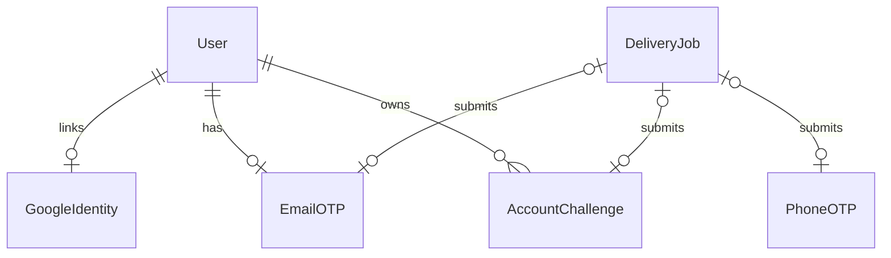
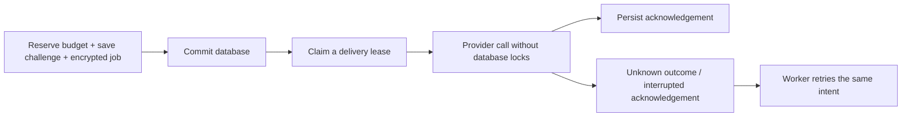

# Learn this project's account system from the beginning

**For:** a beginner learning the Inventory & Sales Management backend.
**Project snapshot:** 12 November 2026.
**Format:** a lesson book, practical workbook, and reference in one Markdown file.

This guide explains the code that is actually in this repository. It includes
email/password accounts, email OTPs, phone OTPs, Google sign-in, JWTs, recovery,
contact linking, admin, PostgreSQL locking, delivery workers, and maintenance.
Examples use fictional details. Use your own email/phone for real delivery.
Example OTPs and tokens are placeholders, never working credentials.

You do not need to understand every advanced chapter on your first reading.
Learn the normal request flow first; return to concurrency and recovery later.

## Contents

1. [How to study this guide](#1-how-to-study-this-guide)
2. [What an account system does](#2-what-an-account-system-does)
3. [The basic vocabulary](#3-the-basic-vocabulary)
4. [How a request travels through Django](#4-how-a-request-travels-through-django)
5. [Where the code lives](#5-where-the-code-lives)
6. [Start the project safely](#6-start-the-project-safely)
7. [Understand the User model](#7-understand-the-user-model)
8. [Managers, passwords, and supported writes](#8-managers-passwords-and-supported-writes)
9. [Serializers and validation](#9-serializers-and-validation)
10. [Your first complete email account](#10-your-first-complete-email-account)
11. [Phone registration and login](#11-phone-registration-and-login)
12. [Understand JWTs, refresh, and logout](#12-understand-jwts-refresh-and-logout)
13. [Sign in with Google](#13-sign-in-with-google)
14. [Password recovery and password changes](#14-password-recovery-and-password-changes)
15. [Add or replace email and phone](#15-add-or-replace-email-and-phone)
16. [Unlink Google without losing access](#16-unlink-google-without-losing-access)
17. [Django admin and permissions](#17-django-admin-and-permissions)
18. [All database models and relationships](#18-all-database-models-and-relationships)
19. [Transactions, concurrency, and locks](#19-transactions-concurrency-and-locks)
20. [Rate limits and spending controls](#20-rate-limits-and-spending-controls)
21. [Delivery outbox and remote-check recovery](#21-delivery-outbox-and-remote-check-recovery)
22. [Cleanup and retention](#22-cleanup-and-retention)
23. [Connect a Flutter application](#23-connect-a-flutter-application)
24. [Test the account system](#24-test-the-account-system)
25. [Development and production settings](#25-development-and-production-settings)
26. [Troubleshooting](#26-troubleshooting)
27. [Complete endpoint reference](#27-complete-endpoint-reference)
28. [Read the implementation in order](#28-read-the-implementation-in-order)
29. [Practice exercises and answers](#29-practice-exercises-and-answers)
30. [Current boundaries and further reading](#30-current-boundaries-and-further-reading)

## 1. How to study this guide

Use three passes:

| Pass | Read | Goal |
| --- | --- | --- |
| First | Chapters 2–12 | Explain registration, verification, login, and tokens |
| Second | Chapters 13–18 and 23 | Use Google, recovery, linking, admin, and Flutter |
| Third | Chapters 19–22 and 24–30 | Understand races, delivery failures, testing, and deployment |

After each flow, find its view, serializer, and model in the source. Draw its
steps on paper. Explain what would happen if the password is wrong, the code
expires, or the provider is unavailable. Understanding failure behavior is part
of understanding authentication.

Use a development database for exercises. Do not reset a database, delete
migrations, run `flush`, or remove lock rows to make an example work.

## 2. What an account system does

An account is a database record representing a person. Login methods are ways
of proving that a request belongs to that record.

In this project, one account can have:

- An email and a usable app password.
- A verified phone for OTP login.
- A linked Google identity.
- More than one of these methods on the **same User row**.

For example, a customer can start with a phone account, attach an email, set a
password, and link Google. The account ID should stay the same through those
steps. Creating a different User for every sign-in method would fragment the
customer's sales/history and permissions.

Three questions guide the implementation:

1. **Identity:** which account/contact are we talking about?
2. **Authentication:** what proof establishes who is making this request?
3. **Authorization:** what may that authenticated account do?

Knowing an email address answers only the first question. It does not prove
ownership. Being signed in also does not automatically make someone an admin.

## 3. The basic vocabulary

| Term | Meaning here |
| --- | --- |
| Django project | The whole backend and its configuration, principally `config/` |
| Django app | A related group of features; `accounts/` contains account behavior |
| DRF | Django REST Framework: the HTTP/JSON API layer |
| Model | Python description of database fields and relationships |
| ORM | Django's Python interface for database queries |
| Manager | Entry point such as `User.objects`, including creation helpers |
| QuerySet | A query such as `User.objects.filter(email=...)` |
| Serializer | Validates API input and/or converts objects to response data |
| View | Handles a request and chooses the response |
| URL route | Maps a path such as `login/` to a view |
| Migration | A versioned change to the database schema or reviewed data |
| OTP | One-time password/code, usually six digits in this application |
| Challenge | Temporary record describing the proof being requested |
| Hash | A one-way representation used for checking a secret |
| Encryption | Reversible protection using a key; needed for delivery retries |
| JWT | A signed token representing app authentication |
| Session | Browser state identified by a cookie and stored server-side here |
| CSRF | Protection against unwanted actions using ambient browser credentials |
| Nonce | A random value binding a Google browser response to one handshake |
| Transaction | A group of database changes that commit or roll back together |
| Lock | Prevents conflicting work from proceeding simultaneously |
| Outbox | Database queue of committed messages still needing submission |
| Worker | A separate process that performs/retries queued work |

Do not confuse a Google ID token, an app access token, an app refresh token,
an OTP, and a CSRF token. They have different issuers and purposes.

## 4. How a request travels through Django

Suppose Flutter sends an email login request:

```http
POST /api/v1/login/
Content-Type: application/json

{"email":"alice@example.com","password":"LearningPass!8247"}
```

The main path is:

```mermaid
flowchart LR
    A[Flutter / browser / API client] --> B[config/urls.py]
    B --> C[api/urls.py]
    C --> D[DRF authentication, permissions, throttles]
    D --> E[Login view]
    E --> F[LoginSerializer]
    F --> G[Django authenticate + User manager]
    G --> H[PostgreSQL]
    H --> I[Check password and account state]
    I --> J[Issue app JWTs and return JSON]
```



Important details:

- `config/urls.py` supplies `/api/v1/`; `api/urls.py` supplies `login/`.
- Authentication/permissions/throttles can reject a request before view logic.
- A serializer decides whether the submitted input has the expected structure.
- The view makes the business decision: for example, email must be verified.
- The database is the final backstop against duplicate or invalid stored state.

A POST body should be a JSON **object**, with quoted field names and strings.
`{"email":"alice@example.com"}` is an object. `[]` is an array, and `null` is
neither an account request nor an empty object.

Common status codes:

| Status | Meaning |
| --- | --- |
| 200 | Operation completed or a documented generic request was accepted |
| 201 | Account created |
| 202 | Delivery accepted as durable work, still pending/uncertain |
| 204 | Success with no response body, such as logout |
| 400 | Invalid input, invalid/expired proof, or a rejected operation |
| 401 | Invalid/missing authentication or invalid credentials/token |
| 403 | Request is understood, but account/policy forbids it |
| 409 | Identity/link conflict |
| 429 | Rate limit/cooldown exceeded; inspect Retry-After |
| 503 | Required verification/limiter service unavailable, busy, or uncertain |

The exact meaning is endpoint-specific. A generic recovery 200 does not confirm
that the email exists. A delivery 202 does not mean the OTP was verified.

## 5. Where the code lives

Links below are relative to this file, so they work in the repository.

| File | What to learn from it |
| --- | --- |
| [config/settings.py](config/settings.py) | Environment, database, JWT, mail and provider configuration |
| [config/security.py](config/security.py) | Production-only security requirements |
| [config/urls.py](config/urls.py) | Main URL prefix and Django admin |
| [api/urls.py](api/urls.py) | Every account API route |
| [accounts/models.py](accounts/models.py) | User, challenges, locks, jobs and receipts |
| [accounts/managers.py](accounts/managers.py) | User creation, lookup and bulk-write policy |
| [accounts/identities.py](accounts/identities.py) | Shared email and phone normalization |
| [accounts/serializers.py](accounts/serializers.py) | Registration/login/legacy OTP input validation |
| [accounts/self_service_serializers.py](accounts/self_service_serializers.py) | Recovery, contact and step-up input validation |
| [api/views/accounts/views.py](api/views/accounts/views.py) | Email/password and phone flows |
| [api/views/accounts/google.py](api/views/accounts/google.py) | Google browser/mobile login and linking |
| [api/views/accounts/tokens.py](api/views/accounts/tokens.py) | Refresh rotation and logout |
| [api/views/accounts/self_service.py](api/views/accounts/self_service.py) | Recovery, contact changes, unlinking |
| [api/views/accounts/responses.py](api/views/accounts/responses.py) | Common token success response |
| [accounts/google_service.py](accounts/google_service.py) | Verification of Google ID-token claims |
| [accounts/google_challenges.py](accounts/google_challenges.py) | Browser nonce creation/reuse |
| [accounts/email_service.py](accounts/email_service.py) | Email verification challenge and delivery intent |
| [accounts/otp_service.py](accounts/otp_service.py) | Local phone OTP generation/hashing and recipient locking |
| [accounts/self_service.py](accounts/self_service.py) | Purpose-bound challenges and ownership checks |
| [accounts/sms_service.py](accounts/sms_service.py) | Console/custom SMS adapters |
| [accounts/twilio_verify.py](accounts/twilio_verify.py) | Twilio Verify HTTP adapter |
| [accounts/outbox.py](accounts/outbox.py) | Encrypted jobs, claims, submission and retry |
| [accounts/remote_checks.py](accounts/remote_checks.py) | Durable Twilio proof receipts |
| [accounts/throttles.py](accounts/throttles.py) | Atomic request limits |
| [accounts/delivery_limits.py](accounts/delivery_limits.py) | Persistent delivery budgets/cooldowns |
| [accounts/recipient_locks.py](accounts/recipient_locks.py) | Stable advisory keys and database clock |
| [accounts/maintenance.py](accounts/maintenance.py) | Batched expiry cleanup and safe pruning |
| [accounts/admin.py](accounts/admin.py), [accounts/forms.py](accounts/forms.py) | Safe admin password/contact handling |
| [accounts/migrations/](accounts/migrations/) | Database evolution |
| [accounts/management/commands/](accounts/management/commands/) | Worker and cleanup commands |

## 6. Start the project safely

### 6.1 Use the existing workspace

In PowerShell:

```powershell
Set-Location -LiteralPath 'E:\django\Inventory & Sales Management'
.\venv\Scripts\python.exe --version
```

The repository records its tested Python version in [.python-version](.python-version)
and exact packages in [requirements.txt](requirements.txt). It currently records
Python 3.14.6. Use those files when reproducing this setup rather than guessing
dependency versions.

The `venv` folder is an isolated Python environment. It separates this project's
packages from other projects. You can activate it, but using its Python directly
also works and avoids PowerShell activation-policy issues.

For a **fresh copy without a venv**, after installing the recorded Python version:

```powershell
py -3.14 -m venv venv
.\venv\Scripts\python.exe -m pip install -r requirements.txt
```

Do not recreate an existing environment as a routine startup step.

### 6.2 PostgreSQL

The running application needs PostgreSQL. Its atomic limiters and advisory locks
do not have a safe SQLite fallback. An old `db.sqlite3` file is not the database
selected by the current settings.

PostgreSQL has a server, databases, and login roles. Django needs the correct
database name, database role, password, host and port. A Django superuser is a
different thing from a PostgreSQL database role.

If starting an entirely new practice database, a database administrator can create
a role and database for you. For this existing project, use its configured local
database; do not create a replacement or delete tables merely to follow a lesson.

### 6.3 Environment variables

`.env` stores local configuration, including private credentials. It is not Python
source code and must not be committed. Here is a **template**, not your actual
credentials:

```dotenv
DJANGO_DEBUG=true
DJANGO_ALLOWED_HOSTS=localhost,127.0.0.1,10.0.2.2
DJANGO_SECRET_KEY=REPLACE_WITH_A_GENERATED_LOCAL_SECRET
PHONE_OTP_SECRET=REPLACE_WITH_A_DIFFERENT_GENERATED_SECRET

DB_NAME=your_database_name
DB_USER=your_database_role
DB_PASSWORD=your_database_password
DB_HOST=localhost
DB_PORT=5432

EMAIL_BACKEND=django.core.mail.backends.console.EmailBackend
PHONE_OTP_BACKEND=local
SMS_BACKEND=accounts.sms_service.console_send_sms
OUTBOX_INLINE_DISPATCH=true
GOOGLE_CLIENT_ID=
```

This configuration prints local email/SMS rather than sending them to someone.
A blank Google Client ID means Google endpoints cannot operate yet.

Generate separate random secrets rather than reusing the literal placeholders:

```powershell
.\venv\Scripts\python.exe -c "import secrets; print(secrets.token_urlsafe(48))"
```

Run it twice for two different values. Do not paste those values into chat or
screenshots. Existing shell environment variables take precedence over `.env`.
Restart long-running processes after changing configuration.

`DJANGO_ENV=production` must be set in the process environment **before Django
starts** to select `.env.production`. Putting that value inside `.env` is not a
substitute: this project chooses which file to load before reading its contents.

### 6.4 Apply migrations and run the processes

```powershell
.\venv\Scripts\python.exe manage.py check
.\venv\Scripts\python.exe manage.py migrate
.\venv\Scripts\python.exe manage.py runserver
```

`migrate` applies schema history to PostgreSQL. `makemigrations` creates migration
files after model changes; it is not required every time you start the server.

A delivery recovery worker is a separate process:

```powershell
.\venv\Scripts\python.exe manage.py process_delivery_jobs --watch
```

The local setup already has a hidden scheduled worker. Avoid accidentally
starting extra workers if you want to see console codes in one specific terminal.
Multiple consumers are supported, but a hidden worker's console OTP output is
not visible in the server terminal. See chapter 21 for operation details.

## 7. Understand the User model

`User` extends Django's `AbstractUser`. That gives it Django's password and
permission machinery while allowing this app to change the identity fields.

| Field | Meaning |
| --- | --- |
| `id` / `pk` | Stable database identity of the account |
| `email` | Optional unique email; stored lowercase, trimmed, or null |
| `phone` | Optional unique normalized Bangladeshi number, or null |
| `password` | Encoded password hash or an unusable-password marker |
| `email_verified` | Ownership of the current email has been established |
| `phone_verified` | Ownership of the current phone has been established |
| `role` | App business label: admin, staff, customer |
| `is_active` | Whether the account is enabled |
| `is_staff` | Django admin access eligibility, alongside its other checks |
| `is_superuser` | Django's broad permission override |
| `groups`, `user_permissions` | Django permission relationships |
| `first_name`, `last_name`, dates | Inherited profile/account metadata |

`username = None` removes the traditional username field. `USERNAME_FIELD =
"email"` tells Django which field is its normal authentication identifier. It
does not automatically implement phone/password login.

### 7.1 At least one contact

A User must retain an email or phone. It may have both. Model validation,
supported saves, admin forms and a database check enforce this.

A Google subject alone is not an exception: Google registration creates a User
with its verified Google email. Removing email is possible through trusted code
only if another allowed contact remains; there is no public contact-removal API.

### 7.2 Verification is about the current value

`email="alice@example.com"` and `email_verified=True` means that particular email
has been verified. It must not mean that every future email on the row is verified.

When an identity actually changes, `User.save()` resets its verification flag
and invalidates related challenges. Equivalent formatting changes preserve
verification: `ALICE@example.com` normalizes to the same identity.

Changing email/phone/password also invalidates pending self-service challenges.
Password changes invalidate existing app tokens through the JWT policy described
later. Ordinary contact changes do not automatically revoke existing JWTs.

### 7.3 Normalization

```text
"  Alice@Example.COM  " -> "alice@example.com"
"01712345678"          -> "+8801712345678"
```

Lowercasing the whole email is this application's chosen identity policy. It
does not remove Gmail dots or plus-address suffixes. Phone support is currently
Bangladesh-only and uses `phonenumbers` validation, not just string replacement.

`blank=True` allows empty form input. `null=True` allows a database NULL. They
are different concepts. Shared normalization converts absent identities to None
so optional unique fields do not become repeated empty strings.

### 7.4 Database constraints

The database prevents duplicate/case-conflicting emails, duplicate phones,
noncanonical stored identities and identity-less users. Python validation gives
friendly errors; database constraints protect against races and other writers.

A canonical-format check is not proof that an email exists or can receive mail.
Verification is the ownership proof. Phone formatting likewise does not promise
that every valid number can receive SMS.

### 7.5 Read basic ORM queries

```python
User.objects.get(pk=1)                         # One row, or an exception.
User.objects.filter(email__iexact="a@example.com")  # A QuerySet, possibly empty.
User.objects.filter(is_active=True).exists()   # A boolean.
User.objects.filter(is_active=True).first()    # First row, or None.
user.refresh_from_db()                         # Reload committed database values.
```

An exception from `get()` is not the same as a None result from `first()`. Both
need handling if a row may disappear. QuerySets are often lazy: building a query
and executing it are separate steps.

The double underscore introduces lookups: `__iexact` means case-insensitive
equality, `__gt` means greater than, `__lte` means less than or equal, `__isnull`
checks NULL, and `__in` checks membership. `pk` means primary key.

Inside database expressions, `Q(a=...) | Q(b=...)` combines conditions with OR;
`&` means AND, and `~` negates a condition. This is how the model describes
“email is present OR phone is present” without fetching every row into Python.

## 8. Managers, passwords, and supported writes

### 8.1 Creating a user in trusted Python code

In a practice Django shell:

```powershell
.\venv\Scripts\python.exe manage.py shell
```

```python
from accounts.models import User

user = User.objects.create_user(
    email="learner@example.com",
    password="LearningPass!8247",
)
user.check_password("LearningPass!8247")  # True
```

The manager normalizes identities, requires a contact, hashes the password and
uses the model's save path. It does **not** send verification mail automatically.
Email registration's view/service explicitly does that work.

Do not assume `create_user()` runs all password-strength validators. In this
project the API serializers/admin forms perform that validation. Trusted scripts
needing the same rules must call `validate_password(..., user=...)` themselves.
For field syntax and choice validation in an import/script, use full_clean()
appropriately too; manager creation is not a universal input-validation boundary.

Never pass arbitrary client JSON directly as `**extra_fields`; role, staff and
superuser fields are trusted server decisions.

### 8.2 Correct password handling

```python
user.set_password("DifferentLearningPass!9358")
user.save(update_fields=["password"])
```

`set_password()` hashes; `save()` persists the new hash. Do not assign plaintext
with `user.password = "secret"`. Custom save logic cannot magically know whether
that string is a legitimate encoded hash or plaintext.

Hashing and password validation solve different problems:

- Hashing protects stored password material.
- Validation rejects weak or email-similar choices.
- `check_password()` checks an input against the encoded hash.

Password whitespace is significant. Registration and login preserve it. An
all-whitespace password is invalid. Do not trim password input in Flutter either.

### 8.3 Passwordless users

```python
user = User.objects.create_user(phone="01712345678")
user.has_usable_password()  # False
```

Omitting the password creates an unusable password, not a blank-password account.
Google-created accounts are also passwordless initially. They can later set a
password using the authenticated/recovery proof flows.

### 8.4 Async creation

```python
user = await User.objects.acreate_user(email="async@example.com", password="AsyncLearningPass!8247")
admin = await User.objects.acreate_superuser(email="admin@example.com", password="AdminLearningPass!8247")
```

These email-based methods delegate to the synchronous creation behavior in a
thread-sensitive worker. They preserve hashing, normalization and save rules.
They do not require a removed `username` argument.
The await examples belong inside an async function. In an ordinary synchronous
Django shell, use create_user()/create_superuser() instead.

### 8.5 Bulk identity writes are prohibited

Runtime `update()`/`bulk_update()` cannot modify email, phone or verification
flags. Bulk user creation is also blocked, including async counterparts.

```python
# Unsupported: raises ValueError.
User.objects.filter(pk=user.pk).update(email="changed@example.com")

# Supported trusted write: triggers normalization/reset/invalidation rules.
user.email = "changed@example.com"
user.save(update_fields=["email"])
```

Unrelated bulk updates remain allowed. Raw SQL and fixture/private bypasses are
reviewed maintenance operations, not application identity-update interfaces.
See [BULK_ACCOUNT_WRITES.md](BULK_ACCOUNT_WRITES.md).

## 9. Serializers and validation

A serializer is an input boundary, not the database itself.

```python
serializer = LoginSerializer(data=request.data)
serializer.is_valid(raise_exception=True)
values = serializer.validated_data
```

- `request.data`: untrusted submitted content.
- `validated_data`: parsed/validated Python values.
- `serializer.errors`: field/general validation errors.
- `serializer.save()`: available when the serializer defines creation/update.
- `serializer.data`: output representation, not a replacement for validated input.

`UserSerializers` exposes id, email and password, with password write-only and id
read-only. It does not expose role/admin switches for public registration.

This project's registration deliberately checks a submitted email first. If it
is already registered, password validation is skipped. After a new email passes,
password validators receive an unsaved User containing that normalized email so
similarity checks have context.

For example, a duplicate email can produce:

```json
{"status":false,"message":"Invalid data","errors":{"email":["This email is already registered."]}}
```

A syntactically valid request can still fail a database constraint if another
request creates the same identity simultaneously. The registration view catches
that identity conflict after rollback and returns a controlled validation error.

`User.save()` implements this application's identity rules, but ordinary Django
`save()` is not a universal substitute for `full_clean()` or API validation.
Different serializers have different strictness; clients should send the
documented object/string types instead of relying on coercion.

## 10. Your first complete email account

Use Postman, another API client, or PowerShell. No frontend is required to learn
the backend. With local console email, read the actual code from terminal output.

### Step 1: Register

```http
POST /api/v1/register/
Content-Type: application/json

{"email":"alice@example.com","password":"LearningPass!8247"}
```

The view validates input, creates the account, creates a hashed EmailOTP and
queues encrypted delivery intent in one transaction. After commit it normally
attempts delivery immediately. The account begins with email_verified=False.

Success is 201. It does not contain login tokens. Provider uncertainty does not
undo the committed account: use resend rather than submitting another registration.

### Step 2: Verify email

```http
POST /api/v1/email/verify/
Content-Type: application/json

{"email":"alice@example.com","otp":"000123"}
```

Replace the example code. Send it as a string so leading zeroes survive.
The service checks the current email, expiry, attempt count and hashed code.
Success sets email_verified=True and consumes the OTP record. It does not log
the user in automatically.

Codes last five minutes and allow five attempts. Do not infer that every resend
must produce different digits; always use the current request/code.

### Step 3: Login

```http
POST /api/v1/login/
Content-Type: application/json

{"email":"alice@example.com","password":"LearningPass!8247"}
```

Wrong credentials return 401. A correct password with unverified email returns
403. A disabled account cannot authenticate. Success returns the common token
response shown in chapter 12.

### Step 4: Resend if needed

```http
POST /api/v1/email/resend-verification/
Content-Type: application/json

{"email":"alice@example.com"}
```

Wait at least sixty seconds between sends. Registration/resend share recipient
budgets. The generic 200 response avoids confirming account eligibility. A new
challenge supersedes the previous one; delivery retries for an existing job
reuse that job's code instead of creating a new challenge.

### PowerShell example

```powershell
$baseUrl = 'http://127.0.0.1:8000/api/v1'
$registerBody = @{email='alice@example.com'; password='LearningPass!8247'} | ConvertTo-Json
Invoke-RestMethod -Method Post -Uri "$baseUrl/register/" -ContentType 'application/json' -Body $registerBody

# Replace with the real local-console code before running this step.
$verifyBody = @{email='alice@example.com'; otp='000123'} | ConvertTo-Json
Invoke-RestMethod -Method Post -Uri "$baseUrl/email/verify/" -ContentType 'application/json' -Body $verifyBody

$loginBody = @{email='alice@example.com'; password='LearningPass!8247'} | ConvertTo-Json
$auth = Invoke-RestMethod -Method Post -Uri "$baseUrl/login/" -ContentType 'application/json' -Body $loginBody
$accessToken = $auth.data.access_token
$refreshToken = $auth.data.refresh_token
$accountId = $auth.data.user.id
```

Those password literals are learning examples and may remain in shell history.
Use proper secret input/storage for real accounts and never display tokens.

### Real Gmail delivery

The project maps EMAIL_BACKEND into Django's MAILERS configuration. Gmail SMTP
defaults are smtp.gmail.com, port 587 and STARTTLS. Configure EMAIL_HOST_USER,
EMAIL_HOST_PASSWORD and optionally DEFAULT_FROM_EMAIL in private environment
configuration, then restart server/worker.

Use an eligible Google app password for this SMTP setup rather than your normal
Google password. Google requires 2-Step Verification for app passwords; account
restrictions can make the option unavailable. [Google app-password instructions](https://support.google.com/accounts/answer/185833).

SMTP acceptance is not proof of inbox delivery. See [EMAIL_SETUP.md](EMAIL_SETUP.md)
and chapter 21 for the queue and provider diagnostics.

## 11. Phone registration and login

Phone sign-in combines registration and login: a valid phone OTP either finds
the existing account or creates a new customer account.

### Step 1: Request a code

```http
POST /api/v1/phone/send-otp/
Content-Type: application/json

{"phone":"01712345678"}
```

Local and +880 forms normalize to the same identity. Local mode prints the code;
it does not send a real SMS. Acknowledged submission returns 200. Pending or
uncertain submission returns 202 with delivery_status. Wait for the code; do not
immediately repeat the send request because a 202 is accepted work.

Here “local testing” means the console configuration from chapter 6. The setting
PHONE_OTP_BACKEND=local by itself means Django generates/checks the code; a
separately configured paid SMS_BACKEND can still send that code as real SMS.

### Step 2: Check the code

```http
POST /api/v1/phone/verify-otp/
Content-Type: application/json

{"phone":"+8801712345678","otp":"000123"}
```

For a valid current proof:

- Existing User: verify its phone and sign in as that same account.
- No User: create a customer with verified phone and unusable password.
- Inactive User: deny sign-in.

Success consumes the phone challenge and returns app tokens. The same successful
challenge cannot issue another token pair. Recipient lock/cooldown rows survive
consumption; deleting the OTP must not immediately allow another SMS.

There is no phone-plus-password login endpoint. Setting a password on a
phone-only account does not invent one. Attach a verified email to use the
existing email/password login endpoint.

### Two phone backends

| Setting | Who generates the actual code? | Who checks it? |
| --- | --- | --- |
| PHONE_OTP_BACKEND=local | Django | Django checks its HMAC; SMS_BACKEND chooses console/custom delivery |
| PHONE_OTP_BACKEND=twilio_verify | Twilio Verify | Twilio check, then Django's durable receipt/ownership checks |

Twilio Verify needs TWILIO_ACCOUNT_SID, TWILIO_AUTH_TOKEN and
TWILIO_VERIFY_SERVICE_SID. This adapter uses account SID/auth-token credentials;
adding arbitrary API-key settings will not automatically change the adapter.
It does not need TWILIO_FROM_NUMBER for Verify. The alternative Programmable
Messaging adapter has different sender/configuration requirements.

Twilio trial Verify recipients must be verified as required by Twilio; using a
trial account does not allow arbitrary recipients. [Twilio Verify documentation](https://www.twilio.com/docs/verify/api/verification).
Do not send to the example phone number using a live provider. Use your own
authorized number. See [SMS_SETUP.md](SMS_SETUP.md) for this project's setup.

## 12. Understand JWTs, refresh, and logout

### 12.1 Common success response

All seven app-token issuers use:

```json
{
  "status": true,
  "message": "Login successful",
  "data": {
    "user": {"id":1,"email":"alice@example.com","phone":null,"role":"customer"},
    "access_token": "<app access JWT>",
    "refresh_token": "<app refresh JWT>"
  }
}
```

Read `data.user`, `data.access_token`, and `data.refresh_token` for email, phone,
Google login/link and token refresh. Token responses use Cache-Control: no-store.
Other endpoints and failures have their own documented bodies.

### 12.2 Access versus refresh

| Token | Current lifetime | Used for |
| --- | --- | --- |
| Access | Thirty minutes | Bearer authentication on protected API requests |
| Refresh | Seven days | Obtain a replacement token pair, or revoke it on logout |

A JWT contains claims plus a signature. Signing detects tampering; it does not
make the payload secret. Do not put passwords, provider credentials or private
application data into tokens. Decoding a token without checking its signature
does not authenticate its owner.

Protected requests use:

```http
Authorization: Bearer <app access JWT>
```

Never put an app refresh token in that header. It is not an access token.

### 12.3 Refresh rotation

```http
POST /api/v1/token/refresh/
Content-Type: application/json

{"refresh":"<current refresh token>"}
```

Success returns the same common envelope, including the current public user.
Replace **both** stored tokens. The submitted refresh token is blacklisted and
cannot refresh again. Each replacement gets a new seven-day expiry; this is not
an absolute seven-day maximum session length.

Serialize refresh calls in the client. If five failed API requests each refresh
the same token independently, only one exchange can succeed. Use one shared
refresh operation and let the others await its result.

This endpoint authenticates the body token and ignores an expired Authorization
header. Many other public endpoints still run default JWT authentication if a
header is supplied, so do not attach a stale Bearer token to public login calls.

### 12.4 Logout

```http
POST /api/v1/logout/
Content-Type: application/json

{"refresh":"<latest refresh token>"}
```

Success is 204, with no JSON body. Delete local tokens. Repeating the same
logout returns 401 because that refresh token is already revoked.

Policy you must understand:

- Logout revokes the submitted refresh token, not other devices' refresh tokens.
- Already issued access tokens remain valid until their thirty-minute expiry.
- Refresh rotation also does not immediately revoke prior access tokens.
- A password hash change invalidates existing access and refresh tokens.
- Inactive/deleted accounts cannot authenticate or refresh.
- Requests already authenticated before a change may finish.

Password-change revocation uses the configured Simple JWT password-revocation
claim; it does not put the plaintext password in the token. See
[JWT_LIFECYCLE.md](JWT_LIFECYCLE.md) and
[AUTH_RESPONSE_CONTRACT.md](AUTH_RESPONSE_CONTRACT.md).

## 13. Sign in with Google

### 13.1 Three different Google-related secrets/credentials

| Item | Meaning |
| --- | --- |
| Gmail SMTP app password | Lets the server send mail through the configured Gmail account |
| Google OAuth Web Client ID | Identifies the Google application/audience |
| Google ID token | Signed identity proof returned by Google sign-in |

None is the user's app password. This sign-in implementation does not use a
Google OAuth client secret. A Gmail address alone is not proof of a Google login.
The Client ID is public application configuration, not a password. SMTP app
passwords and provider auth credentials stay on the server.

Django verifies the Google token, not a client-submitted email or profile object.
Checks include signature/expiry, expected audience, issuer, subject, verified
email and browser nonce where applicable. The app supports gmail.com or a
matching Google Workspace hosted-domain claim for email ownership. Google's
guidance explains why third-party email claims need care:
[Google server-side ID-token verification](https://developers.google.com/identity/gsi/web/guides/verify-google-id-token).

`sub` is Google's stable subject identifier. `GoogleIdentity.subject` links it
to one User. Email matching alone does not automatically attach Google to an
existing account.

### 13.2 Browser flow

Start with the existing test page:

```text
http://localhost:8000/api/v1/auth/google/sign-in/
```

Or implement the handshake:

1. GET `/api/v1/auth/google/config/`.
2. Retain its session/CSRF cookies and response client_id, nonce, csrf_token.
3. Initialize the Google button using the client ID and nonce.
4. Obtain Google's signed credential from the callback.
5. POST it with the same cookies and X-CSRFToken header.

```http
POST /api/v1/auth/google/
Content-Type: application/json
X-CSRFToken: <csrf_token from config>

{"credential":"<Google ID token>"}
```

The browser challenge lasts ten minutes and is bound to the session. Repeated
GETs reuse a valid nonce without extending expiry. A successful exchange consumes
it atomically. Start another handshake after success. GET page/config have their
own shared IP limit before new session creation.

Google login returns app JWTs; it does not establish a Django admin login session.
The supplied page keeps app tokens in frontend memory and has no dashboard
redirect. Refreshing that page loses those in-memory frontend tokens.

### 13.3 Flutter Android/iOS flow

The native SDK obtains a Google ID token for the Web Client ID configured as
GOOGLE_CLIENT_ID on Django. Send:

```http
POST /api/v1/auth/google/mobile/
Content-Type: application/json

{"credential":"<Google ID token>"}
```

Do not attach cookies, an Origin header, or a browser nonce to native exchanges.
The native endpoints reject browser cookies/origins. Flutter Web must use the
browser flow. Native ID tokens can be exchanged again while valid; that is
different from the intentionally one-time browser challenge.

### 13.4 New user versus existing user

- New supported identity/email: create a customer with verified email and no
  usable local password. A second email OTP is not needed for that creation.
- Existing Google subject: authenticate its linked User.
- Existing email without the matching Google link: return 409 with code
  google_link_required. Authenticate the existing account and explicitly link.

For native linking:

```http
POST /api/v1/auth/google/mobile/link/
Content-Type: application/json
Authorization: Bearer <existing app access JWT>

{"credential":"<Google ID token for the matching verified email>"}
```

Browser linking uses `/api/v1/auth/google/link/` with the bearer plus its browser
cookies/CSRF handshake. Linking keeps the existing account ID, role and password.
If the account disappears during a concurrent deletion, the operation denies
with 403/account_unavailable and issues no tokens or replacement account.

Use [GOOGLE_SIGN_IN.md](GOOGLE_SIGN_IN.md) and
[FLUTTER_GOOGLE_AUTH.md](FLUTTER_GOOGLE_AUTH.md) for client/origin/platform setup.

## 14. Password recovery and password changes

Recovery and authenticated change answer different questions:

- **Recovery:** “I cannot log in, but can prove control of an existing verified contact.”
- **Change:** “I am signed in and can supply fresh proof.”

### 14.1 Forgot-password flow

```http
POST /api/v1/password/reset/request/
Content-Type: application/json

{"channel":"email","email":"alice@example.com"}
```

Phone alternative:

```json
{"channel":"phone","phone":"01712345678"}
```

The response contains challenge_id and a generic message. Unknown, inactive or
unverified contacts do not get a redeemable recovery challenge, but receive the
same general response shape. This reduces response-based enumeration; it does
not guarantee identical request timing.
It also does not make the whole API enumeration-proof: registration deliberately
reports that an email is already registered.

Confirm using the returned ID and delivered code:

```http
POST /api/v1/password/reset/confirm/
Content-Type: application/json

{"challenge_id":"<UUID>","otp":"000123","new_password":"ReplacementLearningPass!9358"}
```

Success sets the password, invalidates existing JWTs and pending self-service
challenges, and tells the client to sign in again. It does not issue tokens.
Recovery can set a first password for a passwordless account. It does not attach
an email to a phone-only account or remove Google/phone sign-in methods.

### 14.2 Fresh proof, sometimes called step-up authentication

Sensitive authenticated operations require one of these options:

```json
{"current_password":"<current app password>"}
```

or an OTP to an **existing verified contact**:

```http
POST /api/v1/account/reauth/request/
Content-Type: application/json
Authorization: Bearer <app access JWT>

{"channel":"phone"}
```

The server chooses the signed-in user's current verified phone. A caller cannot
select an arbitrary recipient. Use channel=email for its current verified email.
The response gives a reauthentication challenge ID. The sensitive operation then
includes:

```json
{"reauth_challenge_id":"<reauth UUID>","reauth_otp":"000123"}
```

Supply exactly one proof option. Passwordless users must use the OTP option.
An ordinary login OTP is not a reauthentication challenge, even if its digits
look the same. Challenge purposes, IDs, account binding and snapshots matter.

### 14.3 Change/set a password while authenticated

```http
POST /api/v1/password/change/
Content-Type: application/json
Authorization: Bearer <app access JWT>

{"current_password":"LearningPass!8247","new_password":"ReplacementLearningPass!9358"}
```

Alternatively replace current_password with the two reauth fields. This also
lets a passwordless user set a first password. After success, clear old tokens
and sign in again. Validators compare the new password against the current User.

## 15. Add or replace email and phone

Adding a new identity can create another login/recovery path. Therefore a stolen
access token alone must not be enough: require proof of the **new contact** and
fresh proof of the **current account**.

### 15.1 Email

Request a code for the proposed email:

```http
POST /api/v1/account/email/request/
Content-Type: application/json
Authorization: Bearer <app access JWT>

{"email":"new-address@example.com"}
```

The current email remains unchanged. Confirm with its returned challenge ID,
the new email's code, and an existing-account proof:

```http
POST /api/v1/account/email/confirm/
Content-Type: application/json
Authorization: Bearer <app access JWT>

{"challenge_id":"<new-email UUID>","otp":"000123","current_password":"LearningPass!8247"}
```

For a passwordless user, replace current_password with reauth_challenge_id and
reauth_otp from its existing verified contact.

### 15.2 Phone

```http
POST /api/v1/account/phone/request/
Content-Type: application/json
Authorization: Bearer <app access JWT>

{"phone":"01712345678"}
```

```http
POST /api/v1/account/phone/confirm/
Content-Type: application/json
Authorization: Bearer <app access JWT>

{"challenge_id":"<new-phone UUID>","otp":"000123","current_password":"LearningPass!8247"}
```

The server updates and verifies only after both proofs succeed. A contact already
belonging to another account returns 409; accounts are never silently merged.
The same account ID and role remain. A contact change invalidates related/pending
challenges but does not automatically log out existing app JWT sessions or unlink
the account's Google subject.

### 15.3 Phone-only account to Google-linked account

Follow this sequence:

1. Sign in using the existing phone OTP.
2. Request verification for a new email.
3. Request a reauthentication OTP to the current verified phone. Wait for its
   shared phone cooldown if you just performed phone login.
4. Confirm the email using the email code plus the phone reauth proof.
5. Obtain a Google ID token for that exact verified email.
6. Call the authenticated Google mobile/browser link endpoint.

There is one account throughout this process. New and current-contact codes are
different proofs. If you request two challenge types for the same recipient, the
new issuance can supersede the earlier challenge. Use a different verified
contact or current password when reauthenticating a contact being reverified.

## 16. Unlink Google without losing access

```http
POST /api/v1/auth/google/unlink/
Content-Type: application/json
Authorization: Bearer <app access JWT>

{"current_password":"<current app password>"}
```

The reauth OTP alternative also works. Success is 204. The account must retain
either a verified phone for OTP login or a verified email with a usable password.
Otherwise unlinking returns 400 to avoid removing the last working login method.

For a Google-only user: first set a password using a verified-contact reauth
proof, or attach a verified phone, then unlink. Unlinking does not delete the
User or revoke previously issued app JWTs.

## 17. Django admin and permissions

Create a local administrator interactively:

```powershell
.\venv\Scripts\python.exe manage.py createsuperuser
```

Visit `http://127.0.0.1:8000/admin/`. The email replaces a username in this user
model. The command sets staff/superuser/admin-role defaults, but it does not send
an email OTP or automatically verify email. Admin authentication and the app's
email-verification login policy are separate; app email login still needs email
verification.

### 17.1 Why custom UserAdmin/forms exist

A plain ModelAdmin password text box could save plaintext. The project instead
uses adapted UserAdmin creation/change forms. New passwords are hashed; existing
hashes are displayed read-only with the normal password-change interface.

The admin add form currently requires email. Phone-only accounts can be created
through their API/manager flow and edited in admin. Required-identity validation
prevents clearing both contacts during edits.

Verification flags are read-only in ordinary forms. A deliberate manual override
requires a superuser, a nonempty unchanged identity, a reason, CSRF protection and
a Django admin audit entry. Use it only with real ownership evidence; provider
failure is not evidence that someone owns an address/number.

### 17.2 App roles are not Django permission flags

`role="admin"`, is_staff and is_superuser are separate fields. Assigning an app
role does not magically grant Django admin access or protect every endpoint.

Likewise, configuring JWTAuthentication only identifies callers. A protected
view still needs its permission rule. Teaching example, not an existing route:

```python
@api_view(["GET"])
@permission_classes([IsAuthenticated])
def example_private_view(request):
    return Response({"user_id": request.user.pk})
```

Business endpoints additionally need role/object ownership rules. Hiding an admin
button in Flutter is not authorization. Do not trust a submitted user_id when
the operation should belong to request.user.

## 18. All database models and relationships

| Model | Purpose and relationship |
| --- | --- |
| User | The permanent account and its contact/permission state |
| GoogleIdentity | One linked Google subject per User; subject is also unique |
| EmailOTP | One current registration-email challenge per User |
| PhoneOTP | One current public phone-login challenge per phone; version distinguishes generations |
| AccountChallenge | Temporary purpose-bound reset, reauth, email-change or phone-change proof belonging to a User |
| GoogleBrowserChallenge | One current browser challenge per hashed session binding |
| PhoneOTPRecipient | Persistent cooldown/activity record for a normalized phone |
| AccountChallengeRecipient | Persistent email/phone delivery cooldown/hourly counter/activity |
| ThrottleBucket | Per-scope hashed identity and accepted-request history |
| DeliveryJob | Encrypted delivery intent, attempt/lease/state metadata |
| VerificationReceipt | Durable remote check result bound to record, version, service, SID and code hash |



The diagram summarizes relationships; recipient and receipt bindings also use
keys rather than User foreign keys. For example, a phone OTP can exist before a
User has registered that phone. VerificationReceipt uses a kind/key/version
binding rather than a foreign key that would disappear with local consumption.

Distinguish temporary records from permanent identity links. Deleting an expired
OTP is normal maintenance. Deleting a User or Google link is a different action.

## 19. Transactions, concurrency, and locks

This is an advanced chapter. Read it after you can perform the normal flows.

### 19.1 A transaction protects database changes

```python
with transaction.atomic():
    # Related database changes commit together or roll back together.
    ...
```

If two registrations both ask “does this email exist?” before either inserts,
both can see False. A Python exists check alone is not uniqueness enforcement.
The unique database constraint decides the conflict; the view translates it.

### 19.2 Row locking

`select_for_update()` locks a fetched row until its transaction finishes. It
allows one request to check/update attempts or consume a challenge while a
competing request waits or is denied. The final state must be checked after
acquiring the lock, not only before waiting.

A missing row cannot provide a row lock. That is why first sends and row
deletion/recreation need stable recipient/advisory keys.

### 19.3 Advisory locks and consistent order

An advisory lock protects an application-defined key, even when its table row
does not exist. Supported phone operations acquire the stable phone key before
recipient/user/challenge work. Multiple phone keys are ordered consistently.
Delivery recipients have their own stable namespace; maintenance uses the same
keys. Advisory keys here are independent of signing secrets.

This prevents cleanup from deleting an old lock row while concurrent issuers
split across an old row and a replacement. Skip-locked/nonblocking cleanup
avoids waiting on a key currently in use.

Lock ordering matters: two transactions locking the same resources in opposite
orders can deadlock. Use the existing helpers rather than inventing new orderings.

### 19.4 Recheck after outside work

A Google identity or phone can change while remote verification runs. A returned
provider success must be checked against the current account, challenge version,
expiry, service and nonce before authorizing a local action. A stale snapshot is
not ownership of the account's new identity.

## 20. Rate limits and spending controls

Account throttles use PostgreSQL rolling-window reservations, not cache history.
They lock/create a unique bucket, read database time, prune old timestamps and
reserve a permitted request atomically. Cache clearing or application restarts
do not reset those budgets. Database limiter failures return 503 before protected
view work. PostgreSQL is required; ATOMIC_REQUESTS remains False so reservations
commit before endpoint logic.

Selected defaults:

| Operation | Limits |
| --- | --- |
| Registration | 5/hour per IP; email sending 5/hour and 1/minute |
| Email/password login | 20/hour per IP and 10/hour per submitted email |
| Email resend | 5/hour per IP, sharing email recipient send limits |
| Email OTP check | 30/hour per IP, 10/hour per email, plus challenge attempts |
| Phone send | 10/hour per IP; 5/hour and 1/minute per phone |
| Phone check | 30/hour per IP and 10/hour per phone, plus challenge attempts |
| Google login/link | Shared 20/hour per IP |
| Google page/config | Shared 30/hour per IP |
| Refresh/logout | Shared 60/hour per IP |
| Self-service operations | Shared 60/hour per IP, 30/hour per authenticated account |

Persistent delivery rows add a sixty-second cooldown and a ten-submission fixed
hourly window for the paths using that delivery helper. The normal legacy email
API also has its stricter rolling 5/hour budget. These checks survive disabled
API scopes and are shared across registration/resend/self-service email paths.

Throttles apply to anonymous and authenticated callers. Recipient limits follow
normalized identities across IPs. Each scope reserves independently; a request
denied by one scope can still consume another scope's budget. Invalid credentials
and failed delivery requests can consume request budgets too.

An IP is only useful if the proxy boundary is configured correctly. Do not trust
arbitrary X-Forwarded-For values. NUM_PROXIES must match trusted deployment proxies.

Per-key limits are not a global billing cap. Many different recipients can each
consume their budget, and an intent can have multiple provider attempts. Configure
provider budgets/alerts and ingress limits before public operation. See
[ACCOUNT_RATE_LIMITS.md](ACCOUNT_RATE_LIMITS.md).

## 21. Delivery outbox and remote-check recovery

### 21.1 Why sending inside a transaction is insufficient

A database can roll back its own rows. It cannot unsend an email/SMS already
accepted by another company. Holding a user lock during a slow provider call
also blocks unrelated local work.

This project commits delivery intent before making provider calls:



### 21.2 Job state meanings

| State | Meaning |
| --- | --- |
| pending | Committed intent has not yet been claimed |
| sending | A worker/request owns a temporary lease |
| sent | Submission was acknowledged, not proof of final inbox/handset delivery |
| unknown | Submission outcome was uncertain; eligible for bounded retry |
| failed | Attempt budget exhausted; not proof that no message arrived |
| cancelled | Expired, superseded, consumed or otherwise no longer eligible |

Jobs allow at most three total submissions before the original challenge expiry.
Leases last ninety seconds; configured provider timeouts are ten seconds. Retries
reuse the same encrypted local message/code and do not extend expiry. A current
local code that was delivered can remain redeemable after an acknowledgement
failure or exhausted retry budget. It still needs its valid hash, account binding,
attempt budget and expiry.

Local OTP rows store keyed hashes. Retry jobs need the original message, so their
payload is authenticated Fernet ciphertext using a domain-separated key derived
from PHONE_OTP_SECRET. Success/cancellation erases payloads; expiry cleanup handles
the remaining ciphertext. Drain jobs before rotating the key material.

Delivery can be duplicated after a timeout or crash. Exactly-once delivery is not
promised. Requesting another challenge intentionally supersedes the previous
challenge; a delayed older message can then contain an invalid code.

### 21.3 Remote approval receipts

Twilio checks use a separate sequence:

1. Reserve a check attempt and receipt under short locks.
2. Commit, then call Twilio without database locks.
3. Save its approval/rejection independently.
4. Recheck current ownership and consume locally in a transaction.

If token creation fails after approval was saved, the same exact code can reuse
its durable receipt without another provider check. A concurrent check returns
503/code verification_busy with a short Retry-After.

If the remote outcome or approval write is unknown, the app fails closed with
verification_uncertain and requires a new challenge. It does not assume a later
404 means success. Remote attempt reservations count even when their outcome is
uncertain. This tradeoff protects authentication when provider/database commits
cannot be made atomic.

### 21.4 Operate the worker

OUTBOX_INLINE_DISPATCH=true attempts submission after commit in the normal request.
It still needs a worker for recovery. False queues all submission to the worker.

```powershell
.\venv\Scripts\python.exe manage.py process_delivery_jobs --watch
# Or one bounded pass:
.\venv\Scripts\python.exe manage.py process_delivery_jobs --limit 100
```

The local InventorySales-DeliveryWorker task is configured at user logon and runs
while that user is logged in. Future hosting needs a supervised service. Normal
console OTPs can appear in the server terminal via inline dispatch; a hidden
worker's recovery console output is not visible there. Do not print encrypted
payloads or tokens while debugging.

See [DELIVERY_WORKFLOW.md](DELIVERY_WORKFLOW.md) for monitoring, failure policy,
worker scripts and complete acceptance semantics.

## 22. Cleanup and retention

Expiration rejects a proof immediately. Cleanup later removes its row; those
are separate responsibilities.

| Data | Current cleanup policy |
| --- | --- |
| Legacy email/phone OTPs | Remove expired rows in batches, skipping locked rows |
| Self-service/Google challenges | Remove expired records |
| Django sessions | Remove expired database sessions |
| JWT outstanding/blacklist rows | Remove after token expiry |
| Throttle buckets | Remove expired histories without erasing renewed budgets |
| Delivery ciphertext | Erase on success/cancellation, or at expiry maintenance |
| Delivery metadata | Prune a day after expiry |
| Verification receipts | Remove after challenge expiry |
| Recipient cooldown/activity rows | Prune after thirty days of recorded inactivity, with safety checks |

Recipient cleanup rechecks recent use/send, delivery windows, live proofs and
active locks under the stable advisory key. It never casually deletes a cooldown
row at OTP consumption. Unknown recipient namespaces are retained for review.
Migration 0015 gives existing rows a fresh activity baseline/full retention grace.

Use the combined command:

```powershell
.\venv\Scripts\python.exe manage.py cleanup_auth_artifacts
```

It includes clearsessions, cleanup_account_artifacts, cleanup_google_challenges,
cleanup_account_challenges, flushexpiredtokens, cleanup_throttle_buckets and
cleanup_delivery_state. The account-artifact portion can be run separately:

```powershell
.\venv\Scripts\python.exe manage.py cleanup_account_artifacts --recipient-retention-days 30 --batch-size 500
```

The existing local InventorySales-AuthCleanup task runs at 03:00 Bangladesh time
while the Windows user is logged in. A switched-off/logged-out machine may retain
expired data until a successful run. Cleanup does not send messages or delete
accounts. Future hosting needs its own schedule/monitoring.

Read [ACCOUNT_RETENTION.md](ACCOUNT_RETENTION.md) and
[AUTH_MAINTENANCE.md](AUTH_MAINTENANCE.md) before changing retention or schedules.

## 23. Connect a Flutter application

### 23.1 Base URL

| Client | Typical local server address |
| --- | --- |
| Android emulator | http://10.0.2.2:8000/api/v1/ |
| iOS simulator on the development host | http://localhost:8000/api/v1/ |
| Physical phone | Development computer's reachable LAN IP |

On a real device, localhost refers to the device. Use the computer's LAN address,
bind runserver appropriately for your trusted development network, and configure
ALLOWED_HOSTS/firewall. Production uses HTTPS, not development cleartext rules.
An explicit DJANGO_ALLOWED_HOSTS replaces the development defaults.

### 23.2 One token response parser

The shared contract means every sign-in method can use the same AuthResult
model from [AUTH_RESPONSE_CONTRACT.md](AUTH_RESPONSE_CONTRACT.md).

Conceptual Dio parsing after a successful HTTP 200:

```dart
final envelope = Map<String, dynamic>.from(response.data as Map);
final data = Map<String, dynamic>.from(envelope['data'] as Map);
final user = Map<String, dynamic>.from(data['user'] as Map);
final accessToken = data['access_token'] as String;
final refreshToken = data['refresh_token'] as String;
```

Use platform-appropriate secure storage for native tokens, not debug logs or
ordinary preferences. Keep your client password string exactly as entered.

Client behavior should include:

- A central API client attaching app access JWTs only where appropriate.
- One shared refresh operation and persistence of both replacement tokens.
- Clearing local tokens on logout/session failure.
- Field-error display for registration and password changes.
- Cooldown UI honoring Retry-After, without clearing database rate-limit state.
- Pending-delivery UI for 202/accepted challenge requests.
- Handling verification_busy versus verification_uncertain appropriately.
- Explicit existing-account linking after google_link_required.

Do not assume 204 has JSON. Do not parse every error as the success envelope.
Do not attach a CookieManager or Origin header to native Google endpoints.

### 23.3 Google SDK setup

The existing Flutter guide contains the initialize-once SDK example and platform
setup. Android package/signing identities and iOS bundle/URL configuration must
match the Google application. Its serverClientId is the Web Client ID expected
by Django, not an arbitrary Android client ID. The API receives the Google ID
token, not the user's Google password. Follow
[FLUTTER_GOOGLE_AUTH.md](FLUTTER_GOOGLE_AUTH.md).

## 24. Test the account system

Tests should answer behavior questions, not just repeat implementation details.
For example: can a consumed OTP issue another token pair? Can two requests both
use one browser nonce? Does a failed provider acknowledgement lose the code?

Run the project's isolated PostgreSQL runner:

```powershell
.\venv\Scripts\python.exe -B manage.py test --testrunner=config.postgres_test_runner.PostgresSchemaTestRunner
```

It creates a disposable schema, applies migrations, uses independent PostgreSQL
connections for thread tests, and disables real delivery. It requires permission
to create a schema, not a production database or real delivery credentials.
Do not use production credentials/data to practice tests.

Focused examples:

```powershell
.\venv\Scripts\python.exe -B manage.py test api.test_login --testrunner=config.postgres_test_runner.PostgresSchemaTestRunner
.\venv\Scripts\python.exe -B manage.py test accounts.test_outbox --testrunner=config.postgres_test_runner.PostgresSchemaTestRunner
.\venv\Scripts\python.exe -B manage.py test accounts.test_maintenance --testrunner=config.postgres_test_runner.PostgresSchemaTestRunner
```

Test coverage includes malformed input, password whitespace/similarity, canonical
identities, admin hashing, verification resets, bulk/async policies, Google claims,
session replay, deletion races, strict request limits, recovery/contact proofs,
refresh/logout/revocation, delivery leases/unknown outcomes, and safe cleanup.
The latest recorded full run passed **254 tests on PostgreSQL**.

`TestCase` normally wraps a test in a transaction. Genuine commit/concurrency/
on-commit provider boundary tests use TransactionTestCase so they can exercise
actual commits and independent connections. SQLite/mocked locks do not prove
PostgreSQL row/advisory locking behavior.

Provider mocks prove application decisions, not real inbox/handset delivery.
Live smoke tests require your own authorized recipients and configured providers.
See [TESTING.md](TESTING.md).

## 25. Development and production settings

| Area | Development | Production requirement |
| --- | --- | --- |
| Environment | .env, development profile | Process DJANGO_ENV=production selects .env.production |
| Debug | Can be true | Must be false |
| Secrets | Private local values | Strong, distinct configured secrets shared by all instances |
| Database | PostgreSQL | Shared PostgreSQL primary with appropriate backups/access |
| Email/SMS | Console testing available | Configured delivery providers; no console SMS fallback |
| Hosts | Deliberate local hosts | Explicit real hosts and HTTPS |
| Proxies | Direct development access usually zero proxies | Explicit trusted boundary/proxy count |
| Cookies | Development settings | Secure cookies/CSRF settings under HTTPS |
| Worker | Local logon task or foreground worker | Supervised delivery worker with restart/monitoring |
| Maintenance | Local logged-in-user task | Server scheduler, alerts on missed/failed cleanup |

The project currently has no hosted production deployment. Changing DEBUG to
false alone does not deploy or secure a server. Production validation checks
secrets, hosts and deliberate HTTPS/proxy/HSTS settings. HSTS subdomain/preload
choices are explicitly documented; do not enable them blindly.

Run migrations before traffic uses new schema, deploy consistent code/settings,
restart old processes, and drain/review active jobs before secret rotation.
`check --deploy --fail-level WARNING` checks Django configuration; it does not
prove DNS, real TLS/proxy behavior, provider delivery or complete security.

Keep .env, database snapshots and private exports out of Git. Removing a tracked
file from today's index does not erase earlier commits containing it. Treat
backup/export access as sensitive even when passwords are hashed.

See [PRODUCTION_SETUP.md](PRODUCTION_SETUP.md) and
[DEPENDENCIES.md](DEPENDENCIES.md). `createcachetable` provisions the configured
general-purpose database cache where needed; account limits themselves now use
their migrated PostgreSQL model rather than that cache table.

## 26. Troubleshooting

| Symptom | First thing to check |
| --- | --- |
| DB_PASSWORD missing/startup error | Correct profile/environment and required database values |
| Cannot connect to PostgreSQL | Server running, database/role/password/host/port, not an old SQLite file |
| Undefined table/column | Migrations applied to the same database used by this process |
| Email already registered | Sign in, verify/resend, or recover; do not create another copy |
| Strong-looking password rejected | Similarity/common/numeric/length validators and exact whitespace |
| Correct app password, email login 403 | Email ownership not yet verified, or account policy/state |
| Google-created user cannot use app password | Initially has an unusable password; use Google or set one with proof |
| OTP visible in terminal, nothing on phone | Local console mode intentionally sends no real SMS |
| Phone send 202 | Durable intent accepted; worker/provider status may be pending |
| No console code visible | Which process dispatched it? A hidden recovery worker has separate output |
| Email registered but not delivered | Account may exist with pending/unknown outbox intent; inspect worker/logs and use resend |
| Gmail SMTP fails | Correct mailer options and eligible app password; restart server/worker |
| Twilio rejection/trial restriction | Correct account/service/authorized recipient; inspect sanitized provider diagnostics |
| Invalid/expired OTP | Correct purpose/contact/challenge, current code, leading zeroes, expiry/attempt budget |
| Phone code stops after switching backend | Request a fresh challenge for the active backend/service |
| verification_busy | Retry the check later; another check/delivery is in progress |
| verification_uncertain | Request a new challenge; do not assume provider approval |
| Google config 503 | GOOGLE_CLIENT_ID configured in the running process |
| Google browser CSRF/nonce failure | Same cookies and returned CSRF token; correct nonce and new handshake after success |
| Native Google endpoint 403 with browser | Use browser flow; native endpoints reject Origin/cookies |
| google_link_required | Authenticate existing account and link matching verified email explicitly |
| Google account_unavailable | Account disappeared; restart sign-in rather than assuming a new account was made |
| Refresh used twice | Store the replacement token and serialize refresh calls |
| Logout did not instantly invalidate access JWT | Expected expiry-window policy; submitted refresh was revoked |
| Protected endpoint 401 after password change | Old token deliberately invalidated; sign in again |
| Public endpoint unexpectedly 401 | Client may be attaching an invalid/expired Bearer header |
| Too many requests/429 | Wait per Retry-After; changing cache/IP/account does not reset recipient limits |
| Bulk identity update ValueError | Use supported per-user save/creation paths |
| Cannot clear both contacts | Required-contact invariant |
| App role admin cannot open Django admin | role is distinct from is_staff/is_superuser/permissions |
| Cleanup/worker task not running | User logged in, task enabled, venv/project paths, Last Run Result and environment |

Read logs without dumping credentials, raw request bodies or token/payload
values. Never fix delivery by manually marking an unproven contact verified.

## 27. Complete endpoint reference

Every path below is relative to `/api/v1/`. “Bearer” means an app access token.
All POST examples use application/json. Body field names are case-sensitive.

Fresh proof means **current_password OR both reauth_challenge_id and reauth_otp**.

| Method | Path | Authentication/proof | Body | Success |
| --- | --- | --- | --- | --- |
| POST | `register/` | Public registration | email, password | 201 account + delivery intent; no tokens |
| POST | `email/verify/` | Email OTP | email, otp | 200 verified; no tokens |
| POST | `email/resend-verification/` | Public request | email | Generic 200 |
| POST | `login/` | Email + app password | email, password | 200 common token envelope |
| POST | `phone/send-otp/` | Public request | phone | 200 acknowledged or 202 pending |
| POST | `phone/verify-otp/` | Phone OTP | phone, otp | 200 common token envelope |
| GET | `auth/google/sign-in/` | Browser bootstrap | None | 200 HTML test page |
| GET | `auth/google/config/` | Browser bootstrap | None | 200 client_id, nonce, csrf_token + cookies |
| POST | `auth/google/` | Google credential + browser session/CSRF/nonce | credential | 200 common token envelope |
| POST | `auth/google/link/` | Bearer + matching Google credential + browser handshake | credential | 200 common token envelope |
| POST | `auth/google/mobile/` | Native Google credential; no cookies/Origin | credential | 200 common token envelope |
| POST | `auth/google/mobile/link/` | Bearer + matching native Google credential | credential | 200 common token envelope |
| POST | `token/refresh/` | Current app refresh token in body | refresh | 200 common token envelope, rotated pair |
| POST | `logout/` | Current app refresh token in body | refresh | 204 |
| POST | `password/reset/request/` | Public recovery request | channel + email or phone | Generic 200 + challenge_id |
| POST | `password/reset/confirm/` | Recovery OTP | challenge_id, otp, new_password | 200, sign in again |
| POST | `account/reauth/request/` | Bearer, existing verified contact | channel | 200 + challenge_id |
| POST | `password/change/` | Bearer + fresh proof | new_password + fresh proof | 200, sign in again |
| POST | `account/email/request/` | Bearer | email | 200 + challenge_id |
| POST | `account/email/confirm/` | Bearer + new email OTP + fresh proof | challenge_id, otp + fresh proof | 200 updated/verified email |
| POST | `account/phone/request/` | Bearer | phone | 200 + challenge_id |
| POST | `account/phone/confirm/` | Bearer + new phone OTP + fresh proof | challenge_id, otp + fresh proof | 200 updated/verified phone |
| POST | `auth/google/unlink/` | Bearer + fresh proof + alternative login | Fresh proof | 204 |

These are the current **23 account routes** in api/urls.py. Django admin is a
separate `/admin/` interface. The module does not currently expose a `/me/` route
or a general profile API; do not call invented endpoints from a client.

## 28. Read the implementation in order

For each flow, follow these chains:

```text
Email register:
  api/urls.py -> register -> UserSerializers -> create_user -> User.save
  -> send_verification_email -> reserve_delivery -> EmailOTP + DeliveryJob
  -> commit -> dispatch/worker -> provider

Email login:
  login -> LoginSerializer -> authenticate -> manager lookup/check_password
  -> email_verified policy -> RefreshToken -> authentication_response

Phone login:
  send_otp -> normalized phone + recipient locks/cooldown -> challenge/job
  verify_otp -> local hash or prepared remote receipt -> current-state checks
  -> existing/new User -> consume OTP -> app tokens

Google:
  browser bootstrap when required -> credential verification -> subject lookup
  -> user lock/link/new-account policy -> consume browser challenge -> app tokens

Contact change:
  authenticated request -> target challenge/job -> target OTP + fresh proof
  -> current ownership/conflict checks -> save/reset -> verified flag -> consume

Recovery:
  verified-contact eligibility -> purpose-bound challenge/job -> OTP/new password
  -> password hash change -> JWT invalidation -> sign in again

Maintenance:
  combined command -> expiry cleanup -> stable-key recipient checks/pruning
```

When reading a function, ask: what input is trusted, which state is read, when
are locks held, what commits first, what is consumed, and what does failure leave?

### Python notation you will encounter

| Code | Read it as |
| --- | --- |
| `from accounts.models import User` | Import a class from another module |
| `class User(AbstractUser)` | Define a class inheriting existing Django behavior |
| `self` | This particular object, such as one User |
| `cls` | The class in a class method |
| `super().save(...)` | Continue to the inherited save implementation |
| `**extra_fields` | Additional named arguments collected into a dictionary |
| `getattr(user, channel)` | Read the field whose name is in channel |
| `@api_view(...)` | Decorate a function with DRF request handling |
| `@permission_classes(...)` | Configure its permission policy |
| `@transaction.atomic` | Wrap function database work in a transaction |
| `with transaction.atomic():` | Give one block a transaction boundary |
| `try` / `except` | Handle a known failure, not pretend it did not happen |
| `async def` / `await` | Define/await asynchronous work; not a guarantee of faster queries |
| `with ... as user` | Enter a context that also guarantees its exit/cleanup behavior |
| `class Meta:` | Django model/form configuration, such as constraints |

`transaction.on_commit(...)` waits for the outer transaction to commit, not merely
the innermost nested block. This matters for outbox dispatch and for tests.

JSON is not Python syntax: JSON null/true/false correspond to Python
None/True/False and Dart null/true/false. A DRF Response renders Python objects to
JSON; it does not send a Python dictionary object directly over the network.

### Migration history map

| Migration area | Why it exists |
| --- | --- |
| 0001–0003 | Base User changes, phone OTP and email OTP tables |
| 0004 | Email cleanup/case-insensitive uniqueness |
| 0005–0006 | Stable phone recipient row and Twilio verification references |
| 0007 | Google subject linkage |
| 0008–0011 | Canonical phone/email storage, browser challenge, bulk policy and required contact |
| 0012 | Self-service challenges and delivery recipient state |
| 0013 | Atomic throttle buckets |
| 0014 | Delivery outbox, phone versions and remote receipts |
| 0015 | Recipient activity retention and legacy OTP expiry indexes |

Applied migrations are history, not disposable cache. Data migrations can stop
for collision/invalid-data review rather than guessing which account to merge.
Git tracks migration code; it is not a backup of the live PostgreSQL data.

## 29. Practice exercises and answers

### Exercise A: Explain the email flow

In local console mode, register a fictional practice identity, verify its actual
printed code and log in. Find the User before and after verification.

Answer: the same User id remains; email_verified changes from False to True;
the EmailOTP is consumed; only login returns tokens. Do not print token values
or password hashes merely to check that records exist.

### Exercise B: Observe failure states

Try email login before verifying, then submit a wrong code. Explain which part
rejects each request.

Answer: the email-login policy returns 403 after valid credentials; code checking
returns 400 and increments the allowed challenge attempt count. Do not make more
attempts than needed; limits are real even locally.

### Exercise C: Understand normalization

Compare a mixed-case/spaced email and a Bangladeshi local/+880 phone. Read the
identities helpers rather than creating duplicate accounts.

Answer: each pair maps to one canonical identity. Password spaces are preserved,
unlike email/phone surrounding formatting.

### Exercise D: Trace a refresh

Refresh once and save both returned replacements. Try the old refresh token once.

Answer: the old token is rejected. The new pair uses the same response parser as
login. Existing access-token expiry is independent of this blacklist action.

### Exercise E: Plan a phone-only user's Google link

List the proofs required before linking Google, without manually editing flags.

Answer: phone login; new-email OTP plus current-phone reauth proof to attach that
email; then an authenticated Google link using a signed credential for the exact
matching verified email. Wait for shared send cooldowns between phone requests.

### Exercise F: Inspect an outbox test

Read test_lost_acknowledgement_recovers_same_code_after_lease in
[accounts/test_outbox.py](accounts/test_outbox.py). Why must the retry keep the code?

Answer: the provider may already have delivered it. Generating a new code after
a lost acknowledgement could invalidate what the user received.

### Exercise G: Explain safe pruning

Read the pruning/recreation concurrency test in
[accounts/test_maintenance.py](accounts/test_maintenance.py). Why is the advisory key necessary?

Answer: a row can be deleted, but the stable key continues serializing all
issuers. After cleanup there must still be one new recipient row and one shared
cooldown, not two independent locks.

### Self-check questions

You understand the main design when you can answer these without opening code:

1. Why is email_verified separate from having an email value?
2. Why is a Google ID token different from an app access token?
3. Why can a phone-only User have an unusable password?
4. Why must Flutter preserve password whitespace?
5. Why does changing email reset verification but not necessarily revoke JWTs?
6. Why does logout not immediately stop an old access token?
7. Why does a database unique constraint matter after an exists check?
8. Why must a network call happen after the challenge/job commit?
9. Why is a provider timeout not proof that no message was delivered?
10. Why can cleanup remove an OTP but retain its recipient row?
11. Why is an app admin role not the same as Django superuser permission?
12. Why can passing mocked delivery tests not prove that your phone receives SMS?

Suggested learning sessions: foundations/setup; email; phone/JWT; Google/Flutter;
recovery/linking/admin; outbox/concurrency; tests/retention/deployment. Complete
one flow before moving to the next.

## 30. Current boundaries and further reading

This implementation has explicit boundaries:

- No general profile/account-deletion/contact-removal API is exposed.
- No logout-all-devices or refresh-token-family theft/replay revocation is provided.
- Logout does not immediately revoke already-issued access tokens.
- OTP login alone is not automatically two-factor authentication; a deliberate
  second-factor policy would be a separate feature.
- Native Google sign-in is not a shortcut around browser CSRF/nonce rules.
- Browser cross-origin/CORS deployment is not automatically configured by the
  native Flutter endpoints.
- Provider delivery is at-least-once/uncertain in the documented failure windows,
  not exactly once. Unknown remote approval cannot be manufactured locally.
- No hosted production environment, global provider billing budget or universal
  business-role authorization comes from simply having this account module.
- Passing the test suite is evidence for tested behavior, not a zero-bug or
  production-completeness certificate.

Keep these focused references alongside this lesson:

| Topic | Reference |
| --- | --- |
| Common token response and typed Dart model | [AUTH_RESPONSE_CONTRACT.md](AUTH_RESPONSE_CONTRACT.md) |
| Gmail/local mail configuration | [EMAIL_SETUP.md](EMAIL_SETUP.md) |
| Local/Twilio phone setup | [SMS_SETUP.md](SMS_SETUP.md) |
| Browser Google setup | [GOOGLE_SIGN_IN.md](GOOGLE_SIGN_IN.md) |
| Native Google/Flutter example | [FLUTTER_GOOGLE_AUTH.md](FLUTTER_GOOGLE_AUTH.md) |
| Refresh/logout policy | [JWT_LIFECYCLE.md](JWT_LIFECYCLE.md) |
| Recovery/linking request bodies | [SELF_SERVICE_ACCOUNTS.md](SELF_SERVICE_ACCOUNTS.md) |
| Verification resets and admin exceptions | [IDENTITY_VERIFICATION.md](IDENTITY_VERIFICATION.md) |
| Bulk write boundaries | [BULK_ACCOUNT_WRITES.md](BULK_ACCOUNT_WRITES.md) |
| Atomic request limits | [ACCOUNT_RATE_LIMITS.md](ACCOUNT_RATE_LIMITS.md) |
| Delivery and approval recovery | [DELIVERY_WORKFLOW.md](DELIVERY_WORKFLOW.md) |
| Retention and pruning | [ACCOUNT_RETENTION.md](ACCOUNT_RETENTION.md) |
| Local schedules | [AUTH_MAINTENANCE.md](AUTH_MAINTENANCE.md) |
| PostgreSQL testing | [TESTING.md](TESTING.md) |
| Tested dependencies | [DEPENDENCIES.md](DEPENDENCIES.md) |
| Production preparation | [PRODUCTION_SETUP.md](PRODUCTION_SETUP.md) |
| Findings and remediation evidence | [ACCOUNTS_AUDIT_2026-11-12.md](ACCOUNTS_AUDIT_2026-11-12.md) |

Open this file in a Markdown preview for the tables and diagrams. Markdown stays
editable as the code changes. To make a PDF later, use a Markdown renderer with
Mermaid support and print/export its rendered view; plain-text printing will not
render the diagrams.
