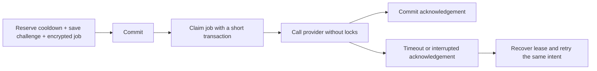

# Durable authentication delivery and verification

OTP delivery uses a transactional PostgreSQL outbox. Provider calls run outside
database transactions and row locks. PostgreSQL remains the durable source of
truth; this implementation does not require Redis or Celery.

## Delivery phases



The challenge and DeliveryJob are committed together. A rollback produces neither
a message nor an orphaned delivery. The normal request uses an on-commit callback
to attempt dispatch immediately; a worker recovers jobs if the request dies
before dispatch or during submission/acknowledgement. This is not an on-commit
callback alone: the durable job exists before the callback runs.

Jobs move through pending, sending, sent, unknown, failed or cancelled. Claiming
uses a short row-lock transaction and a random lease ID. A second worker cannot
claim an active lease. Provider I/O follows after commit. Acknowledgements are
fenced by the lease ID and recheck that the job still belongs to a live challenge;
they cannot resurrect a superseded identity or challenge.

Unknown submissions retry with backoff, at most three attempts before the original
five-minute challenge expires. Sending leases expire after 90 seconds; configured
provider timeouts are ten seconds. Attempts never extend challenge expiry or
generate a replacement local code. Local email/SMS retries decrypt the same
message and resend the same code. A code that reached the recipient remains
redeemable if a submission timed out or its acknowledgement could not commit.
The worker cancels jobs whose challenge was consumed, replaced or invalidated.

Twilio Verify start retries can submit another SMS while recovering a missing
verification reference. A reference is saved only to the challenge still linked
to that exact job. Exactly-once delivery is not claimed: SMTP and the configured
SMS adapters do not provide a shared transaction/idempotency guarantee. A crash
or timeout can produce a duplicate message. Sent means submission accepted,
not final inbox/handset delivery. Expiry, a new code request or an identity change
can still invalidate an older delivered code by policy.

## Encrypted payloads and retention

Jobs contain authenticated Fernet ciphertext, including the destination and
message. The encryption key is domain-separated from PHONE_OTP_SECRET. Existing
OTP rows continue to store hashes, not plaintext codes. Use the same strong
PHONE_OTP_SECRET on every application/worker instance. Drain active jobs before
rotating that secret; old ciphertext cannot be decrypted after rotation.

Successful/cancelled jobs erase their payload immediately. Daily
cleanup_delivery_state erases expired payloads, removes expired verification
receipts, and prunes delivery metadata a day after expiry. It is included in the
existing cleanup_auth_artifacts schedule. Pending/uncertain ciphertext may remain
until the next cleanup run; protect database backups accordingly. Logs contain
exception class names and the adapters' existing sanitized numeric diagnostics,
not credentials, destinations or OTPs. Development console SMS deliberately prints
the code; production retains its existing prohibition on console SMS.

## Remote Twilio checks

Remote checking is also split into phases:

1. Under short recipient/challenge locks, validate the current generation and
   reserve an attempt plus a VerificationReceipt with a lease and code hash.
2. Commit, then call Twilio without any transaction/row lock.
3. Commit the approval/rejection receipt independently.
4. In the normal local login/change transaction, revalidate current ownership,
   expiry, generation, SID/service and the exact approved code before consuming
   the challenge and issuing tokens or changing the contact/password.

A concurrent check returns 503 with code verification_busy and makes no second
provider call. If the local transaction fails after approval was saved, retrying
the same code reuses its durable receipt without calling Twilio again. Identity
edits can proceed during the remote call; a stale approval cannot authenticate
or update the changed account.

An unknown provider result or a crash before approval was saved is fail-closed.
After its lease expires, a checking receipt becomes unknown on the next check.
HTTP 503 with code verification_uncertain requires a new challenge; the app never
infers approval from a later 404. Twilio deletes verification resources after
approval/expiry, so a 404 alone is ambiguous:
[Twilio's verification lifecycle documentation](https://help.twilio.com/articles/360033357033-Verify-V2-returns-a-404-after-Fetching-a-Verification-SID).
No webhook-based approval reconciliation is configured. Remote attempts are
reserved before I/O and count even when the outcome is uncertain; definitive
provider rate limits return 429 and remain retryable within the attempt budget.

## API acceptance and error handling

- Registration returns 201 after creating the account and delivery intent, even
  if immediate submission fails. Its message says delivery may be pending. Use
  email resend, not a second registration, when another code is needed.
- Email resend and password-recovery requests keep generic 200 acceptance bodies
  for privacy. They do not promise that a provider accepted or delivered mail.
- Phone send returns 200 if submission was acknowledged; otherwise 202 with
  delivery_status pending/sending/unknown/failed. This is accepted durable work,
  not an instruction to immediately request another code.
- Authenticated reauthentication/contact requests return a challenge ID and
  message saying delivery may be pending. Confirmations never change identities
  without the required proofs. Token success bodies remain unchanged.
- Invalid input, conflicts, cooldowns and limiter failures retain 400/409/429/503
  behavior. A database failure before enqueue commit cannot claim acceptance.
- Provider errors remain durable job state plus sanitized logs, rather than a
  misleading claim that an already committed account/challenge rolled back.

Submission retries do not reserve another logical send budget. Each intent has
at most three provider attempts; configure external provider budgets and ingress
limits independently. Logical cooldown reservations remain committed on provider
failure, preventing immediate resubmission/spending loops.

## Worker operation

Apply migrations and restart all application processes before using these paths.
Run a persistent worker alongside the Django server:

```powershell
python manage.py process_delivery_jobs --watch
```

For one bounded pass, run `python manage.py process_delivery_jobs --limit 100`.
OUTBOX_INLINE_DISPATCH defaults to true. Set it to false in .env to keep requests
fully queued and leave all submission to the worker. The worker is still required
for recovery when inline dispatch is enabled. Restart processes after settings
changes. All workers must share the PostgreSQL primary, environment/secrets and
provider settings. Production should supervise this command with restart/failure
monitoring and schedule cleanup_auth_artifacts daily.

The local InventorySales-DeliveryWorker task is installed and was verified Running.
For local Windows, scripts/install-delivery-worker.ps1 registers the hidden,
limited-privilege InventorySales-DeliveryWorker task at user logon, with restart
on failure. It uses the project venv and runs while this user is logged in. Start
it after migrating. It is separate from the daily cleanup task. Do not start a
second visible console worker unless you want another supported consumer; local
console OTPs from a hidden recovery worker are not visible in the server terminal.

Inspect pending/failed work without printing payloads:

```powershell
python manage.py shell -c "from accounts.models import DeliveryJob; print(list(DeliveryJob.objects.exclude(state='sent').values('id', 'state', 'attempts', 'last_error', 'expires_at')))"
```

Monitor aged pending/sending jobs, repeated unknown/failed submissions and expiry
rates. Fix provider configuration and request a fresh code when expired/failed;
do not clear local verification flags or manufacture approvals to recover delivery.
Future hosting needs its own supervised worker; this is a local task setup only.

## Validation

PostgreSQL tests assert I/O runs with no active transaction, worker claims are
exclusive, account edits proceed during blocked provider calls, acknowledgements
can fail and recover the same local code/Verify reference, retries are bounded,
superseded jobs cancel, and durable approvals survive local token failures.
Unknown approval outcomes cannot authenticate. Automated tests use mocks and
isolated schemas; no real email/SMS delivery is performed.
